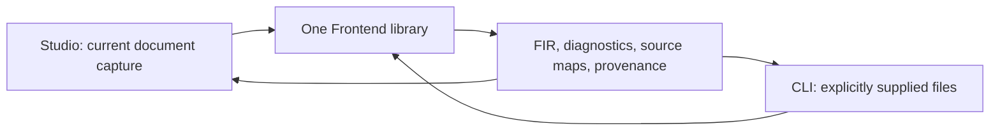
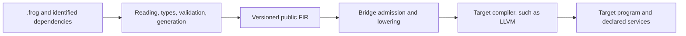
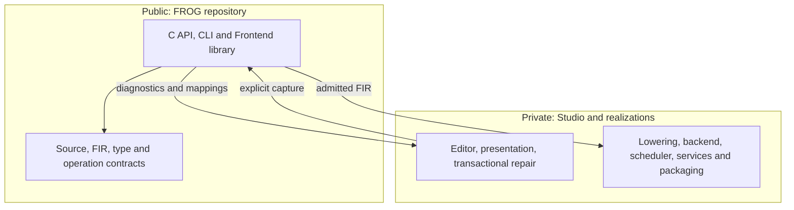

<a id="architecture-commune-et-maintenance"></a>

# Shared architecture and maintenance

The Frontend transforms immutable sources into FIR. It launches no program and chooses no backend on the caller's behalf. Public contracts remain in `sdk/ecosystem` and the FROG repository's Source/FIR specifications; the kit exports them from those owners.







Reading, historical semantic adaptations, types, dependencies and Canonical/Structured/Composed/Event producers have one owner. Studio supplies bytes, preserves history, presents diagnostics and proposes repairs. A repair creates a new state for revalidation; it does not arbitrarily erase a diagnostic. Private presentation data does not become a second semantics.

The resolver receives a reference, its owner and source location. It returns identified, hashed immutable content. The core consults no disk, network, registry or PATH. Conditional context is supplied explicitly; its origin is not inferred from the system hosting the library.

<a id="modifier-et-intégrer-une-version"></a>

## Modify and integrate a version

1. Change rules in the common owner, their contracts and relevant regression tests. Preserve identities, types, exact values and attribution; include rejection and positive cases.
2. Update origin declarations and hashes, then check closure. A partial extraction distinguishes remaining private adapters from public code; third-party copies retain provenance and licenses.
3. Capture a candidate with the existing `tools/export_frontend_candidate.py`, then rebuild, install and use that standalone capture. Its kit manifest is immutable; attach a separate receipt binding its hashes to checks actually executed.
4. Explicitly pin Studio's software version, base commit, exact content, API and admitted options. Compare the same bytes and dependencies through the library, CLI and Studio, then check the affected Run/Highlight/Build/export paths.
5. Maintainers decide publication separately. A new public release never automatically replaces Studio's embedded Frontend.

From the FROG repository root:

```powershell
python -B Implementations/Frontend/tools/export_frontend_candidate.py --frog-root . --output C:/qualification/frontend-source
python -B Implementations/Frontend/tools/export_frontend_candidate.py --verify C:/qualification/frontend-source
```

The output directory must be new. Capture rejects an incomplete or changed inventory. Build commands, the six public tests and an installed-consumer example appear in the [README](../README.md). Inside the Studio workspace, use its build wrapper and lock; do not change inputs while a compiler is running.

<a id="lire-les-preuves"></a>

## Read the evidence

The base commit does not contain a candidate's local modifications. Frontend content SHA, kit-manifest SHA and binary SHAs answer different questions and are all retained. Historical reports remain available with their own scope.

Validation is not target admission; admission is not a successful Build; a Build is not package execution. The matrix keeps these states separate. Studio/CLI comparisons may differ in private message presentation, never in semantic decisions, types or canonical FIR.

Local Windows qualification proves neither another platform nor clean Windows. The Frontend retains its BSD-licensed Zstandard document decoder; it embeds no LLVM, private numerical providers, libffi or Studio execution engine.
