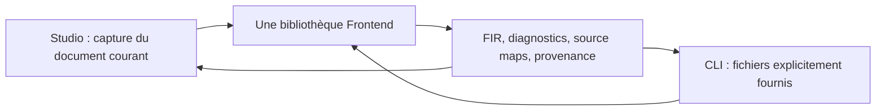
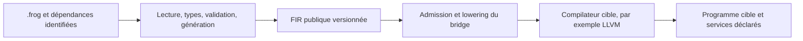
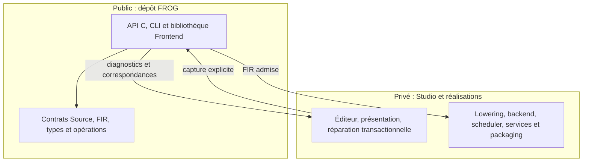

# Architecture commune et maintenance

Le Frontend transforme des sources immuables en FIR. Il ne lance aucun programme et ne choisit aucun backend à la place de l'appelant. Les contrats publics restent dans `sdk/ecosystem` et les spécifications Source/FIR du dépôt FROG ; le kit les exporte depuis ces propriétaires.







La lecture, les adaptations sémantiques historiques, les types, les dépendances et les producteurs Canonical/Structured/Composed/Event ont un seul propriétaire. La couche Studio fournit les octets, conserve l'historique, présente les diagnostics et propose les réparations. Une réparation crée un nouvel état à revalider ; elle ne supprime pas arbitrairement un diagnostic. Les données de présentation privées ne deviennent pas une seconde sémantique.

Le résolveur reçoit une référence, son propriétaire et son emplacement source. Il retourne un contenu immuable identifié et empreinté. Le cœur ne consulte ni disque, réseau, registre ni PATH. Le contexte conditionnel est fourni explicitement ; son origine ne se déduit pas du système hébergeant la bibliothèque.

## Modifier et intégrer une version

1. Modifier les règles dans le propriétaire commun, leurs contrats et les régressions pertinentes. Conserver les identités, types, valeurs exactes et attributions ; inclure des refus et des cas positifs.
2. Actualiser les déclarations d'origine et leurs empreintes, puis vérifier la fermeture. Une extraction partielle distingue les adaptateurs privés restants du code public ; une copie tierce conserve sa provenance et sa licence.
3. Capturer une candidate avec l'outil existant `tools/export_frontend_candidate.py`, puis reconstruire, installer et utiliser cette capture autonome. Le manifeste du kit est immuable ; joindre un reçu séparé liant ses empreintes aux résultats réellement exécutés.
4. Épingler explicitement dans Studio la version logicielle, le commit de base, le contenu exact, l'API et les options admises. Comparer les mêmes octets et dépendances par la bibliothèque, la CLI et Studio, puis vérifier les parcours Run/Highlight/Build/export concernés.
5. Les mainteneurs décident séparément de la publication. Une nouvelle release publique ne remplace jamais automatiquement le Frontend embarqué dans Studio.

Depuis la racine du dépôt FROG :

```powershell
python -B Implementations/Frontend/tools/export_frontend_candidate.py --frog-root . --output C:/qualification/frontend-source
python -B Implementations/Frontend/tools/export_frontend_candidate.py --verify C:/qualification/frontend-source
```

Le répertoire de sortie doit être neuf. La capture refuse un inventaire incomplet ou modifié. Les commandes de construction, les six tests publics et l'exemple de consommateur installé figurent dans le [README](../README.md). Dans le workspace Studio, utiliser son wrapper et son verrou de compilation ; ne pas modifier les entrées sous le compilateur.

## Lire les preuves

Le commit de base ne contient pas les modifications locales d'une candidate. Le SHA de contenu Frontend, le SHA du manifeste du kit et ceux des binaires répondent à des questions différentes et sont tous conservés. Les rapports historiques restent disponibles avec leur propre périmètre.

Un résultat de validation n'est pas une admission cible ; une admission n'est pas un Build réussi ; un Build n'est pas une exécution du package. La matrice conserve ces états séparément. Une comparaison Studio/CLI peut différer dans la présentation privée des messages, jamais dans la décision sémantique, les types ou la FIR canonique.

La qualification locale Windows ne prouve ni une plateforme différente ni un Windows propre. Le Frontend conserve le décodeur documentaire Zstandard sous sa licence BSD ; il n'embarque pas LLVM, les fournisseurs numériques privés, libffi ou le moteur d'exécution Studio.
