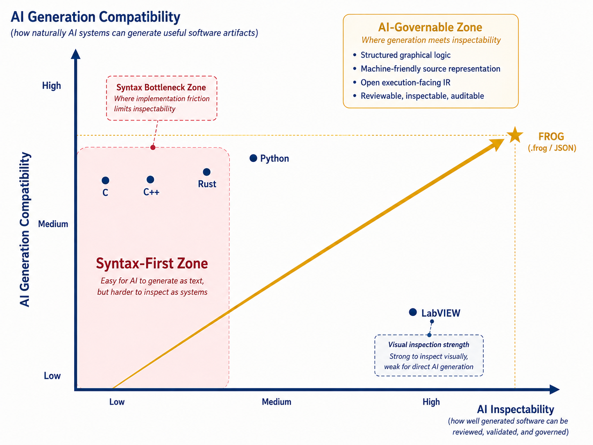

  

<h1 align="center">FROG AI Generation Compatibility vs AI Inspectability Orville Chart</h1>

  <strong>Non-normative strategic positioning note</strong> 
  An illustrative research target combining machine-generatable source and effective human inspection of software. Reviewed 11 November 2026; not a benchmark.

  

<h2>Purpose</h2>

This Orville chart complements the repository's existing positioning chart by focusing on a different AI-era trade-off: <strong>AI generation compatibility</strong> versus <strong>AI inspectability</strong>.

The strategic message is narrow and intentional: the post-AI bottleneck is not only the ability to produce more software artifacts. It is the ability to inspect, validate, govern, and evolve what has been produced.

<h2>Repository visibility</h2>

This page is intended to be referenced from the root <code>Readme.md</code>, <code>FROG-Strategy.md</code>, and <code>Strategy/Readme.md</code> so the chart remains visible from the repository entry points rather than living only as an isolated strategy file.

<h2>Axes</h2>

<table>
  <thead>
    <tr>
      <th>Axis</th>
      <th>Meaning</th>
      <th>High score means</th>
    </tr>
  </thead>
  <tbody>
    <tr>
      <td><strong>AI Generation Compatibility</strong></td>
      <td>How naturally AI systems can generate the software artifact.</td>
      <td>The artifact can be generated directly and structurally by AI-assisted tooling.</td>
    </tr>
    <tr>
      <td><strong>AI Inspectability</strong></td>
      <td>Human inspection of generated software: how accurately people can understand relevant behavior, assess evidence and make a valid correction.</td>
      <td>An intended workflow outcome to evaluate. Graph structure alone establishes neither human effectiveness nor formal correctness.</td>
    </tr>
  </tbody>
</table>

All points live in the positive quadrant. The diagonal arrow is the improvement direction: from isolated generation or isolated inspection toward software artifacts that are both generatable and governable.

<h2>Qualitative coordinates</h2>

The retained illustration is conceptual, not a current capability score or empirical ranking. Its FROG position is a research target. The comparison below describes mechanisms and questions instead of assigning unmeasured product scores.

<table>
<thead><tr><th>Approach</th><th>Relevant capability</th><th>Question for comparison</th></tr></thead>
<tbody>
<tr><td>C, C++, Rust and Python tooling</td><td>Text-oriented generation, analysis, tests, debugging and, for selected tools and properties, formal verification.</td><td>How accurately and efficiently can the engineer follow the consequential behavior and validate a repair?</td></tr>
<tr><td>Graphical engineering environments, including LabVIEW</td><td>Visible dependencies and runtime debugging; AI integration can use APIs or other supported interfaces.</td><td>How much of the complete generation, inspection and correction task is supported for the chosen version and application?</td></tr>
<tr><td>FROG and Graiphic Studio</td><td>Open machine-friendly language foundation and a proprietary dataflow inspection/correction workflow in development.</td><td>Research target: demonstrate faithful mappings and improved human outcomes within an explicit supported scope.</td></tr>
</tbody></table>

<h2>Why FROG targets the upper-right quadrant</h2>

FROG targets the AI-governable zone because its core artifacts are intended to remain both machine-friendly and human-inspectable.

<ul>
  <li><strong>Structured graphical logic:</strong> executable behavior is represented as explicit nodes, ports, connections, structures, interfaces, and observability surfaces.</li>
  <li><strong>Machine-friendly source representation:</strong> canonical <code>.frog</code> source is structured JSON, which is naturally compatible with tooling, validation, deterministic serialization, and AI-assisted generation or transformation.</li>
  <li><strong>Open execution-facing IR:</strong> FIR is treated as an inspectable downstream bridge surface rather than a hidden backend-private object.</li>
  <li><strong>Reviewable, inspectable, auditable pipeline:</strong> source, validated meaning, FIR, lowering, backend contracts, runtime/compiler consumption, and observed behavior can be separated and checked.</li>
</ul>

The claim is not that FROG makes AI-generated systems automatically correct. The claim is that FROG is architected to reduce opacity by pairing AI-generatable structured source with graph-level inspection and open execution-facing artifacts.

<h2>Strategic reading</h2>

The strategic problem is human capacity to follow machine-generated software,
especially where acceptance requires human understanding. FROG provides a structured
model serialized in <code>.frog</code>; Studio's graphical abstraction exposes
relationships, while FIR/IR serve supported compilation and execution.

See <a href="Visual-Programming-and-Human-Control.md">the project philosophy</a>
for the calculator overview, semantic-fidelity requirements and performance boundaries.
Evaluate whether people understand consequential changes and complete valid corrections.
The chart remains qualitative; DARPA-specific research stays separate.

<h2>Boundary</h2>

This chart is strategic and non-normative. It does not define language semantics, conformance rules, source validity, FIR derivation, runtime behavior, or compiler behavior. Those surfaces remain owned by the corresponding specification layers of the repository.

The chart should be read as a communication aid for the AI-era positioning of FROG: a structured language foundation for generated or human-authored logic that still needs accountable inspection, validation, and evolution.

