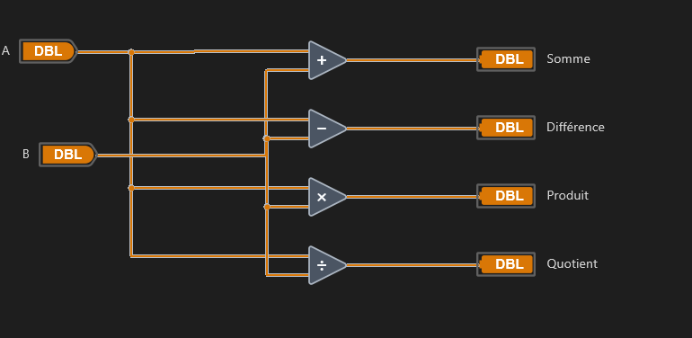

# Write, generate or import FROG

Start with a canonical `.frog` Source document. Choose a target and an exact
Frontend version before you generate a larger graph. For documents that Studio
saves as `frog.document.draft`, use the separate [Studio draft profile](../Expression/Studio%20authoring%20document%20profile%20v1.md)
and its documented migration and repair paths.

## Reading order for generators

1. Choose the format, Studio/Frontend versions and target; read the matching
   [contracts](#1-start-from-a-complete-program). Do not mix Source and Studio
   Draft envelopes or infer port identities from labels.
2. Apply the [layout rules](#lay-out-generated-diagrams-for-left-to-right-dataflow)
   in order.
3. [Validate and derive](#2-validate-derive-and-select-a-target), then use a
   [qualified execution path](#3-qualified-example-paths). State expected and
   observed results separately; validation alone does not prove execution.
4. Finish the [checklist](#final-checklist) and report unsupported content with
   [explicit refusals](#4-deliberate-refusals). The
   [LLM trial](#5-optional-isolated-llm-trial) is optional and separately attributed.

### Name the example file

For a new Studio example, name the entry `.frog` after the example as it
appears in the catalogue. For example, *User Events : inscription, émission,
Flush et nettoyage* becomes `User Events - inscription, émission, Flush et nettoyage.frog`.
Keep meaningful words and accents. Replace characters forbidden in a Windows
filename. If several examples share a title, include the distinguishing type
or case in the name. Keep this filename stable across display languages.

Record the actual relative path in the catalogue. Links and tests should use
that path. The catalogue ID remains stable when an existing example is renamed.

## 1. Start from a complete program

[Example 01](../Examples/01_pure_addition/main.frog) is a complete headless
Source program. Its inputs `a = 2.25` and `b = 3.75` produce `result = 6.0`
in the public reference Runtime. The [source guide](../Expression/Frog%20source%20guide.md)
walks through every section and edge. For a first run through the common
Frontend CLI, use [the complete scalar graph with a Front Panel](../Implementations/Frontend/tests/fixtures/pure-add.frog).
Its controls default to 1 and 2 and its indicator receives 3 in the qualified
reference paths.

Give graph objects stable IDs and connect endpoints by node and port ID.
For an importer, retain the external-to-FROG identity mapping and the complete
types across runs. Report any operation, type or scope that you cannot map.
Widget labels, diagram positions and visual slot order do not define ports.
Keep the original input and write a separate candidate for validation.

| Need | Authority |
| --- | --- |
| Source sections, identities, edges and optional data | [Source guide](../Expression/Frog%20source%20guide.md), [Source schema](../Expression/schema/frog.schema.json), [source profiles](../Expression/Source%20compatibility%20and%20profiles.md) |
| Operation IDs and ports | [Library index](../Libraries/Readme.md), [Core contracts](../Libraries/Core.md), and versioned manifests such as [Add](../Libraries/Manifests/frog.core.add.v1.json) and [Unbundle by Name](../Libraries/Manifests/frog.core.unbundle.by_name.v1.json). Add uses `a`, `b` and `result`. Read each applicable manifest or operation contract for direction, cardinality and typing. The [dated Studio catalogue snapshot](../Profiles/StudioAuthoring.md) helps resolve Studio-specific IDs within its stated version. |
| Types, values and scopes | [Type](../Expression/Type.md), [typed binding](../Expression/Typed%20Binding%20Contract%20v1.md), [numeric representations](../Expression/Numeric%20representations.md) and [structure contracts](../Expression/Control%20structures.md). Retain the Array rank, ordered Cluster fields and Enum domain and items. |
| Front Panel, bindings and events | [Front Panel](../Expression/Front%20panel.md), [widget class contracts](../Expression/Widget%20class%20contract.md), [captured Event profile](../Expression/Event%20Captured%20Profile%20v1.md) and [UI library](../Libraries/UI.md). |
| Dependencies and refusal diagnostics | [Resolver contract](../Implementations/Frontend/frontend-resolution.md), [Frontend outputs](../sdk/ecosystem/docs/frontend-result-contracts.md), [execution eligibility](../Language/Execution%20eligibility.md). |
| Studio versions and tested profiles | [Compatibility matrix](studio-source-compatibility.md), [12 November checkpoint](frontend-checkpoint-2026-11-12.json) and the [qualified example paths](#3-qualified-example-paths) below. |

### Lay out generated diagrams for left-to-right dataflow

Use the target Graiphic Studio version as the authority for sizes, painted
bounds and actual port contacts. These are presentation rules, not additional
language-validity rules. Work in two passes within each region. First place
all objects at their final sizes, with their labels and port clearances.
Then route the wires. If a route would have to go around the chain, revisit
the placement before finalizing the wire.

#### Preserve the program and the editing scope

- Preserve identities, port endpoints, types, values, dependencies, branches
  and execution regions. Geometry never creates a junction or defines a port.
- Respect fixed objects and manual placements outside the requested scope.
  Wire-only cleanup must not move nodes. Report a constrained route rather
  than changing the program or hiding an unresolved layout problem.

#### Keep the overview to one working view

- Design the main diagram so that its inputs, control flow and outputs can be
  followed together at 100% in the target Studio diagram viewport. Check the
  usable canvas after toolbars, with labels and wires visible. Apply the same
  check separately to each displayed Case, loop body and called diagram.
- For an interactive program, keep input handling, state transitions and
  display updates identifiable. Use a loop when state persists across actions
  and an Event or Case for genuine alternatives supported by the target.
  Extract cohesive or repeated work into callable sub-FROGs with named, typed
  inputs and outputs. Supply every callee and resolve it from the delivered
  entry document. Use the selected format's call and interface contract
  ([Source invocation](../Expression/Diagram.md#sub-frog-invocation),
  [Studio draft](../Expression/Studio%20authoring%20document%20profile%20v1.md)).
- If one view overflows, first remove unused gaps, then split at a meaningful
  boundary. Keep standard sizes, readable text and all requested operations.
  Record the viewport, zoom and any region that still requires scrolling.
  This is a generation target, independent of file-format admission.


#### Size and label objects before routing

- Use Studio's standard function sizes: ordinary functions must stay at least
  85% of their standard size, and compact functions at 100%. Control and
  indicator sizes remain editable.
- Put control labels on the left and indicator labels on the right. Put
  other useful labels above or below where there is room, especially for
  wide constants such as arrays. Hide external function and structure labels
  when their icon or caption suffices; retain a label that adds useful meaning.
- Give every supported structure, region and frame a short native subdiagram
  label, such as "Process loop", "True case" or a description of a sequence
  step. Reserve its header area before placing nodes, tunnels and wires.
- Prefer short native labels on clear wire segments, away from bends,
  junctions and terminals. Hide a destination's duplicate diagram label when
  the wire names it clearly; preserve the widget name and binding.
- Reserve the actual text bounds at the final size and font. Fit free
  comments to their text and leave room for their attachment grip.

The [Array, Cluster and Case saved by Studio 0.0.8.419](examples/array-cluster-case-labels.frog)
shows the serialization: `Total` uses `diagram.edges[].label`; Case labels use
each `regions` entry's `title` with `case_structure_subdiagram_label_visible`;
the array label uses `label_horizontal_anchor` and `label_offset`. Adapt the
coordinates to the new diagram instead of copying them blindly.

#### Place clear left-to-right rows

- Put controls on the left, operations in dataflow order and indicators on
  the right, within each execution region. Keep the main path on one
  horizontal row whenever possible; put parallel paths on separate aligned
  horizontal rows. Order terminals by the physical ports they serve.
- Where a node produces both data and error, place the indicators in the
  vertical order of their actual output contacts. If the contacts are closer
  together than the indicator labels, fan the rows outward from the group.
  Give independent test signals, such as a constant driving a demo LED,
  their own clear row.
- Try a straight wire for each individual connection, including references
  and the value port of a compound constant. Align the contacts rather than
  the centers of the node bodies. On a dense fan-in, if aligning two
  producers would overlap their bodies or place a wire behind either one,
  align one producer and give the other a short offset in its own lane.
- **First pass — placement.** Align consecutive functions on their actual
  reference and error contacts first. Reserve separate, direct lanes for
  those two flows before fitting data terminals, constants and indicators.
- Place a constant immediately upstream of the port it feeds. Use the port
  axis if clear. If occupied, place the constant above the consumer for an
  upper input or below it for a lower input, on the input side. Leave enough
  room for a short approach. Size string constants so their contents remain
  readable. A local input should never have to travel around the chain.
- Leave room on both sides of wide or multiport nodes such as Register For
  Events. At 100%, each connected wire should have a visible, individually
  selectable stretch outside the node. Widen just that local gap as needed.
- Keep a visible minimum gap between independent objects and their labels.
  Use Studio's existing layout clearances, reserve wire lanes and increase
  spacing where actual text or port bounds require it. Shorter wires never
  justify overlap or loss of this gap. Native labels on their own wire and
  integrated components retain their existing placement contracts.

#### Straight wires and port alignment

- **Second pass — wiring.** Route references and the complete error cluster
  first, then data. For each link in a generated error chain, use a straight
  connection or, if alignment is impossible, at most one short local offset
  between the two port levels. With horizontal ports that offset has one
  vertical segment. A trip around a node group or the diagram perimeter
  fails the layout check. Return to placement if a second offset is needed.
- Choose the shortest readable orthogonal route that respects clearance,
  obstacles, ports and region boundaries. With comparable length and
  clearance, prefer fewer bends.
- **No unnecessary staircase wiring.** If output and input can be aligned
  with a clear passage, align them and use one straight horizontal segment.
  Remove short jogs, zigzags and obsolete bends caused only by misplacement.
  This also applies to a string constant feeding a Case selector or tunnel.
- If endpoints must remain on different rows, use horizontal approaches
  joined by one continuous vertical segment where the passage is clear.
  Extra bends must serve an actual obstacle, port approach, branch or wall.
- Give independent wires separate lanes. Share a trunk only for real branches
  of the same source port in the same execution region; keep actual junctions
  and remove redundant parallel segments. If unavoidable, a crossing is
  perpendicular and has no junction.
- Bring successive functions closer until the visible gap still accommodates
  their terminals, labels, a branch if needed and a selectable stretch of
  wire. Keep extra space where a real obstacle or a bus of wires needs it.
- Between independent parallel wires, leave a continuous visible strip of
  canvas between their painted strokes at 100%. Check long trunks as well
  as short approaches to ports. Distinct coordinates alone can still look
  like one thick line. Keep same-source junctions intact and fan out near a
  crowded connector when its fixed port pitch limits local clearance.
- For stacked branches descending to a collector on the right, try the lowest
  branch on the leftmost vertical lane, with higher branches farther right.
  Preserve collector input identities and priority, and tunnel connections on
  both sides of each wall. Check every Case region separately.

**Worked example — two DBL inputs feeding four operations**



Follow A and B separately from the controls on the left. Each source branches
along its own vertical trunk. A feeds the first operand on every row and B the
second, preserving the order for subtraction and division. A perpendicular
crossing between A and B has no junction dot. If the two trunks share any
length of the same line on screen, move one into a clear lane.

Align each result port with its own palette-standard DBL Numeric Indicator.
In the theme shown, the four terminals are orange, with the labels Somme,
Différence, Produit and Quotient on the right. Use the palette terminal and
binding for the document's type and theme. The image illustrates the layout.

#### Lay out a readable fan-in

For three independent producers feeding a multi-input function, put their
outputs in the same vertical order as the function's actual input contacts.
Align the middle producer with its input and put the result indicator to the
right on the actual output axis. Both of these links can then be single
horizontal segments.

Give the upper and lower producers separate horizontal approach rows. Bring
each to its contact with one short vertical offset where the corridor is open.
The two vertical sections can use the same column only if their spans are
disjoint and a visible gap remains between them. If two offsets would share
any portion of a line, move one producer or give its offset a different
column. Keep a visible gap around the bodies, labels and each wire stroke.

At 100%, follow every link from producer to contact and check the brief
approaches beside the function as well as the long runs. Preserve the input
order and the intended branches when improving the placement.

#### Keep error flow explicit

- For a new example with error flow, connect a native Error Cluster Control
  to the first error input on the left. Carry the complete ordered cluster
  (status, code, source) through the chain. Connect the last function's
  error output directly to a native Error Cluster Indicator on the right.
- Unbundle only when the example explicitly teaches error fields or the
  requested program actually consumes a field. Expected status and code
  can be asserted by a test on the complete cluster. They do not call for
  an Unbundle and two scalar indicators on the teaching diagram.
- In a User Events example, keep the message constant just above Generate
  User Event when its data port is above the reserved error lane. Keep the
  U32 count beside Flush Event Queue with a single short offset if needed.
  The last Destroy User Event supplies the complete error indicator.
- Honor each operation's error contract: standard incoming errors skip normal
  work and propagate unchanged; documented cleanup or execute-on-error paths
  still apply. Use an Error Case for an authored execution guard. Selecting
  a result with Select does not prevent its producers from executing.

#### Final checklist

- [ ] At 100%, the main flow and each displayed region fit the recorded working view or have a documented reason for overflow. Called files resolve and expose their actual typed ports.
- [ ] Each pair of independent parallel runs has visible background between strokes. Adjacent functions use the space needed for reading and editing.
- [ ] Each fan-in keeps independent arrivals separate through their final approach. Aligned producers and the result indicator use a straight link wherever the passage is clear.
- [ ] Objects and text have clear spacing, with no unintended overlap.
- [ ] Main and parallel paths read left to right; actual out/in contacts are
  aligned wherever permitted, with no removable staircase or needless length.
- [ ] Follow each reference and error wire from port to port. Check for
  perimeter detours and multiple offsets. Check that each local constant
  approaches from the appropriate side and the final error cluster is whole.
- [ ] Wires are anchored and orthogonal, with intentional junctions and
  justified bends; inspect every Case at 100% in Studio.
- [ ] Identities, endpoints, regions, types and values are preserved. For a
  layout-only edit, compare them and run the same inputs before and after.
- [ ] Check observed outputs against expectations. For an error-flow change,
  test both normal execution and a known incoming error, including required
  cleanup. Report what was actually validated and what remains unchecked.

## 2. Validate, derive and select a target

Run these PowerShell commands from the repository root with `frog-frontend.exe`
on PATH, or set `$cli` directly to its absolute path. The
[Frontend README](../Implementations/Frontend/README.md) gives the standalone
build commands. Use the exact kit and inspect `describe`. These commands use
the complete scalar with Front Panel and write their outputs under the
temporary directory.

```powershell
$cli = (Get-Command frog-frontend.exe -ErrorAction Stop).Source
$out = Join-Path ([IO.Path]::GetTempPath()) ('frog-generator-' + [guid]::NewGuid())
New-Item -ItemType Directory -Path $out | Out-Null
$src = @(
  '--source', 'Implementations/Frontend/tests/fixtures/pure-add.frog',
  '--source-uri', 'fixture:/generator/ui.frog',
  '--document-id', 'source:ui',
  '--fir-document-id', 'fir:ui',
  '--source-format', 'frog.source',
  '--source-version', '0.1',
  '--fir-version', '0.1'
)
& $cli describe --descriptor-output (Join-Path $out 'descriptor.json')
if ($LASTEXITCODE -ne 0) { throw 'Frontend describe failed' }
& $cli validate @src --diagnostics-output (Join-Path $out 'validate.json')
if ($LASTEXITCODE -ne 0) { throw 'Source validation failed' }
& $cli derive @src --output (Join-Path $out 'program.fir.json') `
  --diagnostics-output (Join-Path $out 'derive.json') `
  --source-maps-output (Join-Path $out 'maps.json') `
  --provenance-output (Join-Path $out 'provenance.json')
if ($LASTEXITCODE -ne 0) { throw 'FIR derivation failed' }
```

1. **JSON and schema.** Check UTF-8 JSON and the envelope against its schema.
   For a set of existing conformance cases, use the repository's
   [reference validator](../Implementations/Reference/Validator/Readme.md).
2. **Semantic validation and FIR.** Run the common Frontend with the declared
   Source format, version and semantic profile. If the graph requires dependencies,
   pass the explicit `--semantic-context` and `--dependencies` inputs documented
   by the [CLI](../Implementations/Frontend/README.md). Retain diagnostic codes,
   source URIs and pointers as supplied. A nonzero exit blocks the next step.
3. **Target admission.** Submit FIR and required provenance to the selected
   backend. Its capability list guides selection. Its whole-graph validation
   decides whether it can build or run the program.
4. **Execution.** Compare observed outputs and faults with explicit expectations
   on that target. Derivation alone supplies no observed value.

### Run a generated program

For an editable Studio document on Windows, pass the saved file path to the
installed Graiphic Studio executable. For the Windows portable distribution,
set the path to its copy of GS.exe.

```powershell
$studio = 'C:\Graiphic Studio\GS.exe'
$program = (Resolve-Path -LiteralPath '.\generated.frog').Path
& $studio $program
```

In Studio, check that the document is ready to run, enter the intended control
values, then click **Run**. Compare the observed indicator values or diagnostics
with the expected results. The command above opens the editor. Studio currently
has no documented command that runs an arbitrary saved .frog headlessly and
returns its outputs.

For supported programs that need to run independently of Studio, use
**Build** in Studio and launch the exported .exe with its accompanying
dependencies. For command-line validation or FIR generation, use the Frontend
commands above. The [qualified execution paths below](#3-qualified-example-paths)
list the public reference targets and the examples each actually ran.

## 3. Qualified example paths

The examples below use Source and FIR 0.1 where applicable. The CLI replay used
**Frontend 0.2.0-local, API 3**, content
`c815f0a1e9d5f466598f5e780cec556d3b046d71b326b98502bee49f7f0df9a9`,
the checkpoint associated with **Studio 0.0.8.094**. Execution receipts below
name the actual execution owner. For the public Python reference Runtime
examples, run from the repository root:

```text
python -B -X utf8 Implementations/Reference/Runtime/check_examples01_10_runtime_acceptance.py
```

| Source | Tested gates and expected result |
| --- | --- |
| [Scalar, Example 01](../Examples/01_pure_addition/main.frog) | Schema and Python reference Runtime acceptance pass. `result = 6.0` for 2.25 + 3.75. The checkpoint CLI refuses this public-interface corridor with `IR_PUBLIC_INTERFACE_UNSUPPORTED`. |
| [Scalar with IHM, Example 02](../Implementations/Frontend/tests/fixtures/pure-add.frog) | Schema, CLI validation and FIR pass. [Python reference oracle](../Implementations/Reference/Runtime/acceptance/example02_ui_value_roundtrip.snapshot.json) gives `ind_result = 3.0`. The [C counterpart](../Implementations/Bridges/reference-c/examples/core-add.frog) also produced 3 on its qualified native target. |
| Case branch | The [canonical structure fixture](../Conformance/valid/11_public_structure_families/case.frog) passes the public schema checks. The combined fixture receives `EVENT_IR_OBJECT` in the checkpoint CLI. The separate [Studio Draft 2 example](../Examples/Native/Structures/structure.case.bool.true/main.frog) selects the True branch and produces I64 `41` in a native-fast run, verified against the [example index](../Examples/index.v1.json). |
| [For with three iterations](../Implementations/Bridges/reference-c/examples/for-3.frog) | Schema and checkpoint CLI/FIR pass. The [native oracle](../Implementations/Bridges/reference-c/examples/expected/for-three.json) records an I64 seed of `9007199254740993` and result `9007199254740996`. |
| [Array build, index and size](../Implementations/Bridges/reference-c/examples/array-32.frog) | Schema and checkpoint CLI/FIR pass. For index 31 the [native oracle](../Implementations/Bridges/reference-c/examples/expected/array-last.json) records shape `[32]`, length 32 and element 31.25. |
| [Cluster/Record exact values](../Implementations/Frontend/tests/fixtures/record-exact.frog) and [nested Array/Cluster/Enum](../Implementations/Frontend/tests/fixtures/nominal-nested.frog) | Schema and checkpoint CLI/FIR pass. [Frontend contract checks](../Implementations/Frontend/tests/frontend_integration.cpp) verify exact I64/U64, negative zero and NUL in the Record and preservation of the complete nested nominal schema and data. Native-fast replays of separate Studio draft examples check [Array to Cluster](../Examples/Native/array/array.to-cluster.padding/main.frog) with fields 7, 8, 0 and [ordered Unbundle](../Examples/Native/cluster/cluster.unbundle.order/main.frog) with `9007199254740993` and `"kept"`. |
| [Enum with Front Panel, Example 08](../Examples/08_enum_value_roundtrip/main.frog) | Schema and Python reference Runtime acceptance pass. `fault` reaches both `result_mode` and `mode_result`. The checkpoint CLI refuses this public-interface corridor. The separate [Studio Enum Case](../Examples/Native/Structures/structure.case.enum.exact/main.frog) produces I64 `41` in the native-fast replay. |
| [Captured Event with Front Panel](../Implementations/Frontend/tests/fixtures/event-product.frog) | Schema and checkpoint CLI/FIR pass. The Studio native headless owner ran the same Source bytes with a captured Value Change from 2.5 to 12 and a bias of 3. The `sum` indicator receives 15. The public-only replay covers Source and FIR; native dispatch uses Studio’s LLVM owner. |

The Studio draft replays used native-fast with example runner SHA-256
`4220cd38dafdc92865628026611ea18e41786be43775d178e81a3c3a0a0dfd05` and the
public [example index](../Examples/index.v1.json). The Event replay used the
Studio native handoff test owner SHA-256
`3a92e1e92d7d0ec37af7a10f9a3aed1c6326f7b3d500c0a8fd6459aecaf4bd06`.
Those component runs use their own binaries. They cover neither interactive
desktop use nor an exported Event EXE.

The [reference C corpus](../Implementations/Bridges/reference-c/examples/corpus.json)
contains inputs, expected results, negatives, source hashes and frozen FIR
hashes. The standalone finite target `graiphic.reference-c/windows-x64/native-fast`
was qualified with API 3 during the **Studio 0.0.6.766** integration. The public
CLI executable used in that qualification has SHA-256
`2af8361e0c90b85d8d8dbd70187759988ffe28505bc7845e2666ed85a685ad8f`
and the peer `0e499db34b23d41d06621dd946f816a239c440c7fe183ea3c2c4d37578d06cff`.
The checkpoint CLI replay above does not requalify C execution. For an exact-kit
rerun, use the [bridge setup](../Implementations/Bridges/reference-c/README.md)
and its [public corpus runner](../Implementations/Bridges/reference-c/tests/run_public_corpus.py).
From the repository root, set `$cli` and `$peer` to the exact installed
executables. `compiler.json` is the inventory next to the peer as described in
the bridge setup. The output directory must be new.

```powershell
$proof = Join-Path ([IO.Path]::GetTempPath()) ('frog-reference-c-' + [guid]::NewGuid())
python -B -X utf8 Implementations/Bridges/reference-c/tests/run_public_corpus.py `
  --frontend $cli --peer $peer --compiler-config compiler.json `
  --sdk-root sdk/ecosystem --output-root $proof
```

The runner also compares fresh FIR hashes to the frozen corpus. A mismatch
requires a newly attributed qualification before reporting equivalent execution.

## 4. Deliberate refusals

| Gate | Witness and expected result |
| --- | --- |
| Envelope | [Missing required section](../Conformance/invalid/01_missing_required_section/case.frog) fails the Source schema and the CLI reports `frontend.source_envelope_invalid`. |
| Semantics | Copy the CLI scalar fixture and change the first edge's destination port from `a` to `generated_wrong_port`. The JSON shape passes and CLI validation rejects the endpoint with `IR_ENDPOINT`. |
| Target admission | [Nominal Enum](../Implementations/Bridges/reference-c/examples/unsupported-enum-u32.frog) and [subtraction](../Implementations/Bridges/reference-c/examples/unsupported-subtract.frog) derive FIR. The qualified finite C target refuses them with `reference_c.nominal_type_unsupported` and `reference_c.operation_unsupported`. |
| Runtime fault | [Array index below zero](../Implementations/Bridges/reference-c/examples/inputs/array-negative-index.json) is an input to an admitted graph. The native oracle expects `ARRAY_INDEX_RANGE` and zero published outputs. |

## 5. Optional isolated LLM trial

Use a fresh session with an already authorized model. Supply only the public
revision, [the compact index](../llms.txt) and the documents it links. Ask for a
complete scalar with a Front Panel, using two non-default input values and a
stated expected indicator result. Ask for the authorities behind every
operation and port. Then request a second candidate with an unsupported port
and an explanation of which gate should reject it. Save the exact prompt,
model/version and unedited responses. Check both files against the schema and
the Frontend; check the valid result on an admitted target. Record elapsed time,
manual corrections, diagnostic codes and observed outputs separately. No LLM
trial is part of the qualification recorded above.
