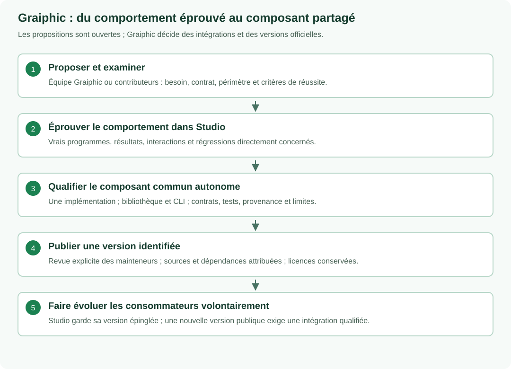
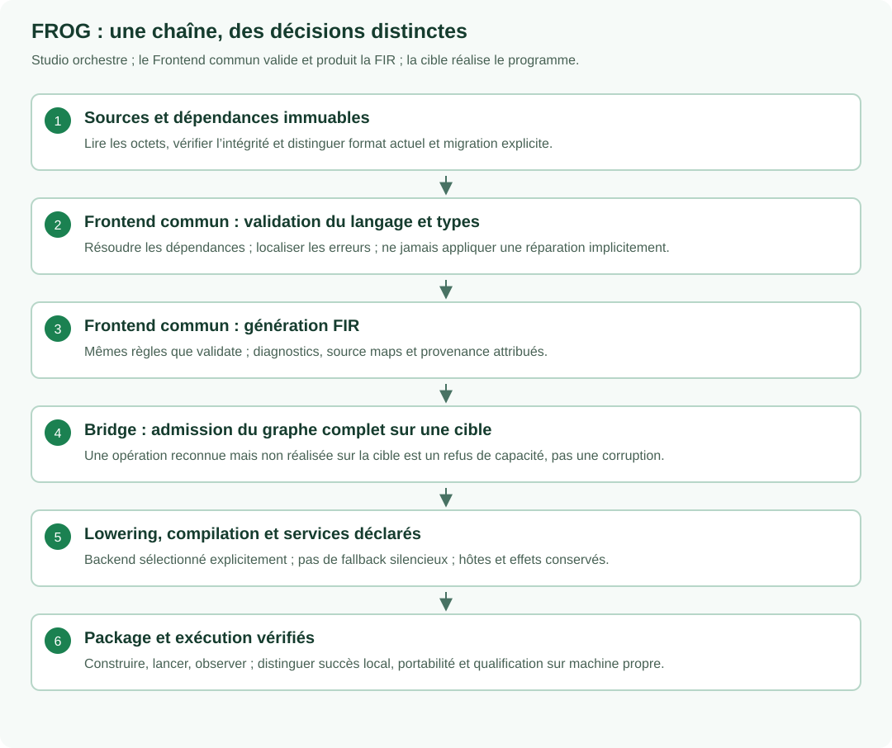

# Graiphic: leadership, sharing and validation

Graiphic leads the official project while opening selected code and contracts to the ecosystem. External proposals are welcome; acceptance remains an explicit maintainer decision. This note explains the [governance rules](../GOVERNANCE.md#official-project-rules), without changing licenses or creating a second policy.

**Summary:** Graiphic leads official development and releases. Contributions are open and reviewed. Shared production components are proven in Studio, qualified independently, then published as identified versions. Studio and public tools consume one implementation; updates are explicit and validated.

## A leading product and an open ecosystem

Studio provides integration and orchestration: document editing, diagnostics, proposed repairs, backend and service selection, execution, observation and Build. The goal is a powerful, extensible environment with control over the whole pipeline. That goal is not evidence that a particular device, function or deployment is already supported: published profiles and results determine support.

Graiphic directs the roadmap, architecture and official releases. Anyone may report an issue or propose an improvement. A proposal does not come with a promise of integration; review considers usefulness, correctness, compatibility, security, relevant performance, maintainability and licensing. A substantial revision request, deferral or rejection includes a concise reason. Rights to use, modify, redistribute and fork remain governed by the licenses; official names and trademarks are separate.

## Prove, share, then integrate explicitly

Components originating in Studio follow this path: proven behavior in Studio, independent qualification of the common component, then publication of an identified version. A contribution may be proposed publicly at any time; required evidence precedes the relevant official integration or release. A documentation-only correction does not require an IDE build.

After extraction, **one implementation** serves Studio and public tools. The CLI hosts the same Frontend library; it is neither a second FIR generator nor a mandatory external step for every Studio edit. Required contracts are public; the complete editor, repairs and other private parts do not automatically become public.

Studio pins the qualified version, its content identity and its configuration. A newer public release never silently replaces that component. Updating a consumer is an explicit operation, with the checks directly relevant to the change.

## Validate each stage for what it demonstrates

| Decision | Question addressed |
|---|---|
| Reading and integrity | Can the bytes be read without loss or ambiguity? |
| Format and migration | Is the format recognized? Is an explicit migration required? |
| Language and types | Are dependencies, terminals, connections, regions, values and effects valid? |
| Target admission | Do the backend and its providers implement the complete graph within their declared profile? |
| Compilation and deployment | Can the program be compiled, linked and packaged with its dependencies? |
| Execution | Has the package actually run in the stated environment? |

The common Frontend is the authority for semantic validation and FIR. It does not implicitly repair the document. Studio proposes and applies repairs as editing transactions, then submits the result to the same Frontend.

A valid program that is not implemented on a target is **unsupported on that target**, not corrupt. An interrupted or incomplete check remains indeterminate. Successful compilation does not prove execution, and a local run does not qualify a clean Windows installation or every device. Diagnostics must retain the stage, category, code, severity and affected objects/source locations.

Painting simply means drawing the interface. It consumes a published prepared state attributed to the document, its revision, dependencies and target. It must not repeat expensive processing on each repaint. This separation permits neither Run without the corresponding admission nor silent execution of an older snapshot.

## Dependencies chosen for their value

Control over the product does not require rewriting everything. A proven, optimized library may be the best choice. A replacement must offer a demonstrated benefit, preserve contracts and be verified. Dependency count or an “in-house” label is not a measure of quality. Origins, licenses and notices remain preserved, including for adapted third-party code.

## Human understanding and assurance

Our product direction is continuity of informed human control from generated logic to executable results. The open FROG foundation and the proprietary Studio experience have complementary roles. Readable dataflow, hierarchical inspection and actionable correction should make engineering judgment more effective; their benefit needs comparison on complete tasks.

Human inspection, semantic checks, tests, simulation and formal verification are complementary. Each claim must name the property, artifact, assumptions and trusted components involved. A proof of exported code does not automatically prove the source mapping or a separate product binary. Verification-tool integration remains a proposed research direction; the [inspection and assurance note](../Strategy/Inspection-and-Assurance.md) defines its current scope and limits.

## Attributed evidence and visible limits

Always distinguish implementation, compilation, testing, local delivery, GitHub publication and qualification on an independent machine. A bounded success does not qualify an entire palette. Publishing a retained failure does not turn it into a PASS.

The [9 November 2026 Frontend checkpoint](frontend-checkpoint-2026-11-09.json) identifies its corpus and limits, following the [2 November checkpoint](frontend-checkpoint-2026-11-02.json); the [build instructions](../Implementations/Frontend/README.md) describe the standalone component. Changes retain their own versions and evidence. Existing licenses, the [CLA](../CLA.md) and the [contribution process](../CONTRIBUTING.md) continue to apply.
